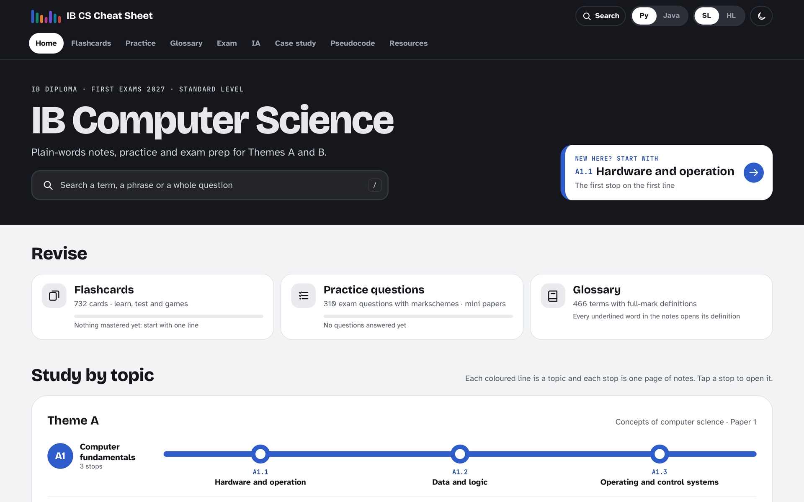
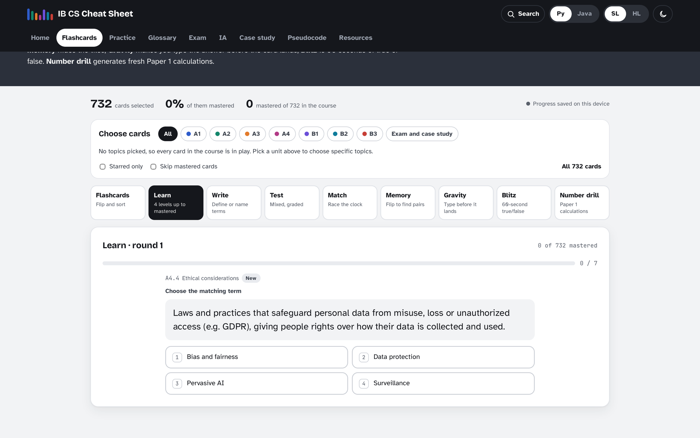
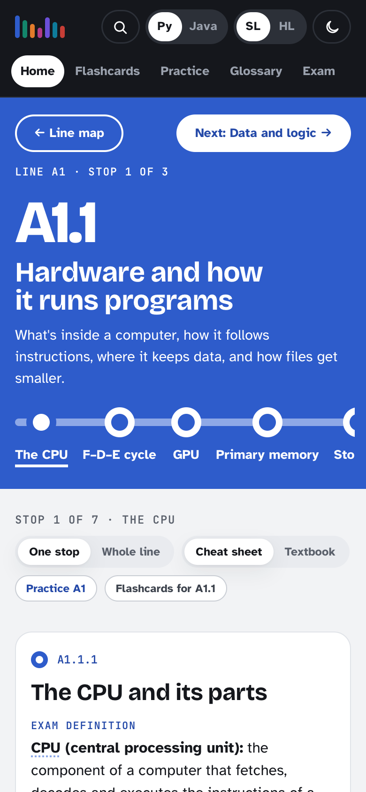

<div align="center">


# IB Computer Science Cheat Sheet

**Free SL and HL notes for the IB Diploma Computer Science course (first exams 2027).**
Every topic in plain words, with flashcards, exam-style practice, a glossary and exam guides, all in one fast site.

[](https://d1v4nchik.github.io/dpcomputerscience27/)


[](https://github.com/d1v4nchik/dpcomputerscience27/commits/main)

<br>

<picture>
  <source media="(prefers-color-scheme: dark)" srcset=".github/screenshots/home-dark.png">
  
</picture>

</div>

## What's inside

|                             | Standard Level | Higher Level |
| --------------------------- | -------------: | -----------: |
| Topic pages                 |             16 |           23 |
| Flashcards                  |            732 |        1,170 |
| Exam-style questions        |            313 |          499 |
| Glossary terms              |            466 |          683 |

Plus 83 diagrams, 27 videos, and guides for the exams, the IA, pseudocode and the 2027 case study.

## Features

- **Notes as a transit map.** Each syllabus topic is a coloured *line*, and each page of notes is a *stop*. Every section has an exam definition, a plain-words explanation and an analogy.
- **Cheat sheet or Textbook.** Switch between quick revision points and full written explanations.
- **SL / HL toggle.** HL-only content is hidden until you need it.
- **Python / Java toggle.** All Theme B code examples come in both languages.
- **Flashcards.** Flip, *Learn* (four mastery levels), *Write* (mark yourself like an examiner), *Test*, and four games: Match, Memory, Gravity and Blitz. *Number drill* generates fresh Paper 1 calculations.
- **Practice.** Filter the question bank by topic, command term, marks or status. Write an answer, open the markscheme and tick the points you made, or sit a timed mini paper.
- **Glossary.** Every term with a full-mark definition. Underlined words in the notes open their definition in place.
- **Search everything.** Press <kbd>/</kbd> to search terms, notes and questions.
- **Your progress stays on your device.** No account, no ads, no analytics. Progress is saved in your browser.
- **Light and dark mode.** Works on phones as well as laptops.

## Syllabus coverage

HL-only pages are marked **HL**.

**Theme A: Concepts of computer science (Paper 1)**

| Line | Topic | Pages |
| :--- | :--- | :--- |
|  | Computer fundamentals | A1.1 Hardware and operation · A1.2 Data and logic · A1.3 Operating and control systems · A1.4 Translation **HL** |
|  | Networks | A2.1 Network fundamentals · A2.2 Network architecture · A2.3–4 Transmission and security |
|  | Databases | A3.1–2 Relational design · A3.3 SQL · A3.4 Beyond relational **HL** |
|  | Machine learning | A4.1 Machine learning fundamentals · A4.2 Preparing data **HL** · A4.3.1–5 Learning from data **HL** · A4.3.6–10 Rewards, evolution, neurons **HL** · A4.4 Ethical considerations |

**Theme B: Computational thinking and programming (Paper 2)**

| Line | Topic | Pages |
| :--- | :--- | :--- |
|  | Computational thinking | B1.1 Thinking like a programmer |
|  | Programming | B2.1 Fundamentals · B2.2 Data structures · B2.3 Control structures · B2.4–5 Algorithms and files |
|  | Object-oriented programming | B3.1 Classes and objects · B3.2 Inheritance and design **HL** |
|  | Abstract data types **HL** | B4.1 Linked lists, trees, sets, hashes **HL** |

**Guides:** Exam toolkit · Internal assessment (IA) · 2027 case study · Pseudocode help · Resources

## Screenshots

<table>
  <tr>
    <td width="50%"><br><sub><b>Topic page.</b> Stops along the line, exam definitions and diagrams.</sub></td>
    <td width="50%"><br><sub><b>Flashcards.</b> Learn mode, plus Write, Test and four games.</sub></td>
  </tr>
  <tr>
    <td width="50%"><br><sub><b>Practice.</b> Filter by topic, command term and marks, then self-mark.</sub></td>
    <td width="50%"><br><sub><b>Glossary.</b> Every term with its full-mark definition (dark mode).</sub></td>
  </tr>
</table>

<p align="center">
  
  &nbsp;&nbsp;
  
</p>

## Run it locally

It's a static site with no build step and no dependencies.

```bash
git clone https://github.com/d1v4nchik/dpcomputerscience27.git
cd dpcomputerscience27
python3 -m http.server 8000
```

Then open <http://localhost:8000>. Any static file server works.

## Project structure

```
.
├── index.html            # Page shell, plus every topic page and diagram as <template>s
├── assets/
│   ├── css/style.css     # All styles, light and dark themes
│   ├── js/data.js        # Course content: topics, glossary, flashcards, question bank
│   ├── js/app.js         # Router, search, flashcards, practice and number drill
│   └── img/              # Social preview image
├── favicon.svg
├── robots.txt
└── sitemap.xml
```

It's deployed with GitHub Pages straight from `main`.

## Corrections and suggestions

Spotted a mistake, a typo or something that doesn't match the 2027 syllabus? Please [open a correction](https://github.com/d1v4nchik/dpcomputerscience27/issues/new?template=correction.yml). Include the topic code (for example *A2.1*) and, if you can, a source. Ideas are welcome too: [make a suggestion](https://github.com/d1v4nchik/dpcomputerscience27/issues/new?template=suggestion.yml).

## Disclaimer

> [!NOTE]
> These are independent study notes. They are not affiliated with, endorsed by or connected to the International Baccalaureate Organization. "IB" and "International Baccalaureate" are trademarks of the International Baccalaureate Organization. Always check against the official subject guide and your teacher.
