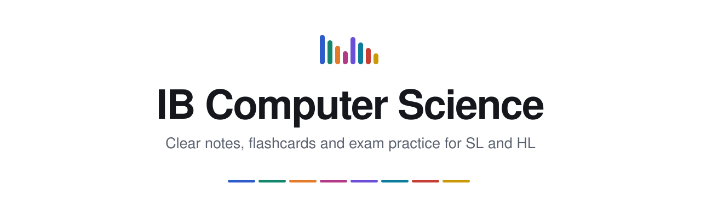

  <a href="https://d1v4nchik.github.io/dpcomputerscience27/">
    <picture>
      <source media="(prefers-color-scheme: dark)" srcset=".github/banner-dark.svg">
      
    </picture>
  </a>

  <a href="https://d1v4nchik.github.io/dpcomputerscience27/"><b>Open the notes</b></a>
  &nbsp;&nbsp;&middot;&nbsp;&nbsp;
  <a href="#for-students">Students</a>
  &nbsp;&nbsp;&middot;&nbsp;&nbsp;
  <a href="#for-teachers">Teachers</a>
  &nbsp;&nbsp;&middot;&nbsp;&nbsp;
  <a href="#offline">Offline</a>

Free. No account. No ads. First exams 2027.

 

  <a href="https://d1v4nchik.github.io/dpcomputerscience27/">
    <picture>
      <source media="(prefers-color-scheme: dark)" srcset=".github/screenshots/home-dark.png">
      
    </picture>
  </a>

 

<table>
  <tr>
    <td width="33%" valign="top">
      <b>Learn</b> 
      Every topic explained in everyday words first, then in the words that get marks. Short and long versions, diagrams and videos.
    </td>
    <td width="33%" valign="top">
      <b>Remember</b> 
      1,394 flashcards with Learn, Write and Test modes, and a glossary of 719 full-mark definitions.
    </td>
    <td width="33%" valign="top">
      <b>Practise</b> 
      546 exam-style questions with markschemes, timed papers and step-by-step specimen paper walkthroughs.
    </td>
  </tr>
</table>

 

<h2 id="for-students">For students</h2>

Open the notes, choose **SL** or **HL** at the top, and pick a topic. A good routine for each topic:

1. Read the notes until the idea makes sense.
2. Go through its flashcards until they're mastered.
3. Answer a few practice questions and mark them with the markscheme.

Closer to the exam, work through the specimen papers. Your progress saves on your device automatically, and <kbd>/</kbd> searches everything.

<h2 id="for-teachers">For teachers</h2>

Free to use with your classes, with nothing for students to sign up for.

- **Share** the link <a href="https://d1v4nchik.github.io/dpcomputerscience27/">d1v4nchik.github.io/dpcomputerscience27</a>, or copy the address of any topic page to send that page.
- **Set homework** such as mastering a topic's flashcards or self-marking its practice questions.
- **Teach with it** on a projector, using the full textbook view and the diagrams.
- **No data collected.** No accounts, ads or tracking. Progress stays in each student's browser.

<h2 id="offline">Offline</h2>

**Install it as an app** to keep every topic on your device. It works without internet and updates itself when you're back online. In Chrome or Edge, click *Install* in the address bar. On an iPhone, tap *Share*, then *Add to Home Screen*.

Or <a href="https://github.com/d1v4nchik/dpcomputerscience27/releases/download/offline/ib-cs-notes-offline.html">download a single file</a> for a laptop. It opens with a double-click and needs no internet, but **it does not update itself**. It will tell you when a newer copy is out.

 

<b>Topics covered</b>

 

**Theme A: Concepts of computer science (Paper 1)**

| Line | Topic | Pages |
| :--- | :--- | :--- |
|  | Computer fundamentals | A1.1 Hardware and operation · A1.2 Data and logic · A1.3 Operating and control systems · A1.4 Translation **HL** |
|  | Networks | A2.1 Network fundamentals · A2.2 Network architecture · A2.3–4 Transmission and security |
|  | Databases | A3.1–2 Relational design · A3.3 SQL · A3.4 Beyond relational **HL** |
|  | Machine learning | A4.1 Machine learning fundamentals · A4.2 Preparing data **HL** · A4.3.1–5 Learning from data **HL** · A4.3.6–10 Rewards, evolution, neurons **HL** · A4.4 Ethical considerations |

**Theme B: Computational thinking and programming (Paper 2)**

| Line | Topic | Pages |
| :--- | :--- | :--- |
|  | Computational thinking | B1.1 Thinking like a programmer |
|  | Programming | B2.1 Fundamentals · B2.2 Data structures · B2.3 Control structures · B2.4–5 Algorithms and files |
|  | Object-oriented programming | B3.1 Classes and objects · B3.2 Inheritance and design **HL** |
|  | Abstract data types **HL** | B4.1 Linked lists, trees, sets, hashes **HL** |

**Guides:** Exam toolkit · Internal assessment (IA) · 2027 case study · Pseudocode help · Resources

<b>Questions</b>

 

**Do I need a GitHub account?** No. This page is only where the notes are kept. You need one only to send a correction.

**Is this official IB material?** No. These are independent study notes, not made by, endorsed by or connected to the International Baccalaureate Organization, whose trademarks "IB" and "International Baccalaureate" are. Always check against the subject guide and your teacher.

**Can I share it?** Yes, please share the link. The notes are &copy; d1v4nchik, all rights reserved, so don't copy, repost or sell the content.

 

Spotted a mistake? <a href="https://github.com/d1v4nchik/dpcomputerscience27/issues/new?template=correction.yml">Send a correction</a>. &nbsp;&middot;&nbsp; Want to help? See <a href="CONTRIBUTING.md">CONTRIBUTING.md</a>.

