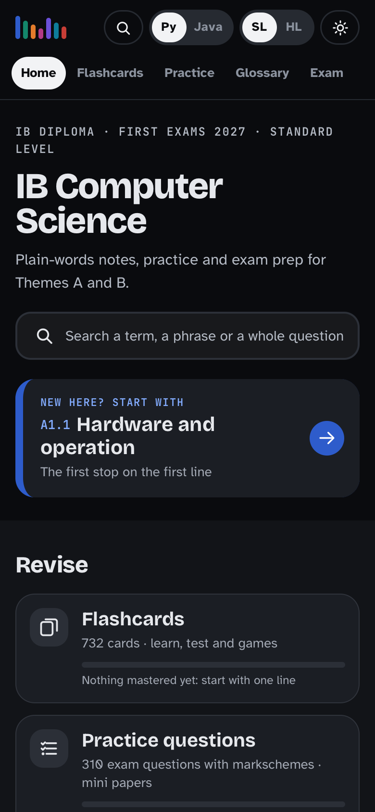

# IB Computer Science Cheat Sheet

**Free SL and HL notes for the IB Diploma Computer Science course (first exams 2027).**
Every topic in plain words, with flashcards, exam-style practice, a glossary and exam guides. No sign-up, no ads, nothing to install.

 

<picture>
  <source media="(prefers-color-scheme: dark)" srcset=".github/screenshots/home-dark.png">
  
</picture>

## Start studying

You don't need to download anything. **[Open the notes](https://d1v4nchik.github.io/dpcomputerscience27/)** in any browser, on your laptop or your phone, and you always get the newest version. Bookmark it, or press <kbd>/</kbd> on any page to search.

Your flashcard and practice progress is saved in your browser on that device. There's no account, so it doesn't move between devices.

## Use it without internet

Revising on a plane, on the bus, or somewhere with bad wifi? There are two ways.

### Option 1: Install it as an app (recommended)

Install the site and it keeps a copy of every topic on your device. It opens offline, and **it updates itself** the next time you're online.

| Device | How |
| :--- | :--- |
| Laptop (Chrome or Edge) | Open the site, then click the **Install** icon at the right of the address bar. |
| iPhone or iPad (Safari) | Tap **Share**, then **Add to Home Screen**. |
| Android (Chrome) | Tap the **⋮** menu, then **Install app** or **Add to Home screen**. |

Open the site once while you're online before you go offline, so it has time to save the notes.

### Option 2: Download one file

A single HTML file with all the notes, flashcards and practice questions. Save it anywhere and double-click it to open it in your browser, no internet needed. Best on a laptop.

> [!WARNING]
> **A downloaded copy does not update itself.** Corrections and new questions only reach the live site and the app. If you open the file while you're online it will tell you when a newer copy is out, so you can download it again. If you can, use Option 1 instead.

## What's inside

|                             | Standard Level | Higher Level |
| --------------------------- | -------------: | -----------: |
| Topic pages                 |             16 |           23 |
| Flashcards                  |            907 |        1,394 |
| Exam-style questions        |            346 |          546 |
| Glossary terms              |            497 |          719 |

Plus 83 diagrams, 136 linked videos (one for almost every syllabus point), and guides for the exams, the IA, pseudocode and the 2027 case study.

## Features

- **Notes as a transit map.** Each syllabus topic is a coloured *line*, and each page of notes is a *stop*. Every section has an exam definition, a plain-words explanation and an analogy.
- **Cheat sheet or Textbook.** Switch between quick revision points and full written explanations of every stop.
- **Videos on every stop.** A short video for that exact syllabus point, plus links that jump to the right minute of longer lectures.
- **SL or HL.** HL-only content stays hidden until you switch it on.
- **Python or Java.** All Theme B code examples come in both, so pick the one your school teaches.
- **Flashcards.** Flip, *Learn* (four mastery levels), *Write* (mark yourself like an examiner), *Test*, and four games: Match, Memory, Gravity and Blitz. *Number drill* gives you fresh Paper 1 calculations every time. Quick-answer cards explain *why* the answer is right.
- **Exam practice.** Filter questions by unit, Paper 1 or Paper 2, command term or marks. Write your answer, open the markscheme and tick off the points you made, or sit a timed paper with Paper 1’s Section A / Section B split. *Open in the notes* jumps to the stop that teaches the idea.
- **Glossary.** Every term with a full-mark definition, with *Learn these* and *Test me* for each topic. Underlined words in the notes open their definition in place.
- **Exam, IA and case study guides.** How each paper works, what the command terms want, how to plan your IA, and the 2027 case study.
- **Light and dark mode**, on phones as well as laptops.

## Syllabus coverage

HL-only pages are marked **HL**.

**Theme A: Concepts of computer science (Paper 1)**

| Line | Topic | Pages |
| :--- | :--- | :--- |
|  | Computer fundamentals | A1.1 Hardware and operation · A1.2 Data and logic · A1.3 Operating and control systems · A1.4 Translation **HL** |
|  | Networks | A2.1 Network fundamentals · A2.2 Network architecture · A2.3–4 Transmission and security |
|  | Databases | A3.1–2 Relational design · A3.3 SQL · A3.4 Beyond relational **HL** |
|  | Machine learning | A4.1 Machine learning fundamentals · A4.2 Preparing data **HL** · A4.3.1–5 Learning from data **HL** · A4.3.6–10 Rewards, evolution, neurons **HL** · A4.4 Ethical considerations |

**Theme B: Computational thinking and programming (Paper 2)**

| Line | Topic | Pages |
| :--- | :--- | :--- |
|  | Computational thinking | B1.1 Thinking like a programmer |
|  | Programming | B2.1 Fundamentals · B2.2 Data structures · B2.3 Control structures · B2.4–5 Algorithms and files |
|  | Object-oriented programming | B3.1 Classes and objects · B3.2 Inheritance and design **HL** |
|  | Abstract data types **HL** | B4.1 Linked lists, trees, sets, hashes **HL** |

**Guides:** Exam toolkit · Internal assessment (IA) · 2027 case study · Pseudocode help · Resources

## Screenshots

<table>
  <tr>
    <td width="50%"> <b>Topic page.</b> Stops along the line, exam definitions and diagrams.</td>
    <td width="50%"> <b>Flashcards.</b> Learn mode, plus Write, Test and four games.</td>
  </tr>
  <tr>
    <td width="50%"> <b>Practice.</b> Filter by topic, command term and marks, then self-mark.</td>
    <td width="50%"> <b>Glossary.</b> Every term with its full-mark definition (dark mode).</td>
  </tr>
</table>

  
  &nbsp;&nbsp;
  

## Found a mistake?

Spotted an error, a typo or something that doesn't match the 2027 syllabus? Please [send a correction](https://github.com/d1v4nchik/dpcomputerscience27/issues/new?template=correction.yml). Mention the topic code (for example *A2.1*) and, if you can, where you checked it. Ideas for new features or topics are welcome too: [make a suggestion](https://github.com/d1v4nchik/dpcomputerscience27/issues/new?template=suggestion.yml). You need a free GitHub account to post either.

Want to help edit the notes directly? See [CONTRIBUTING.md](CONTRIBUTING.md).

## Disclaimer

> [!NOTE]
> These are independent study notes. They are not affiliated with, endorsed by or connected to the International Baccalaureate Organization. "IB" and "International Baccalaureate" are trademarks of the International Baccalaureate Organization. Always check against the official subject guide and your teacher.
