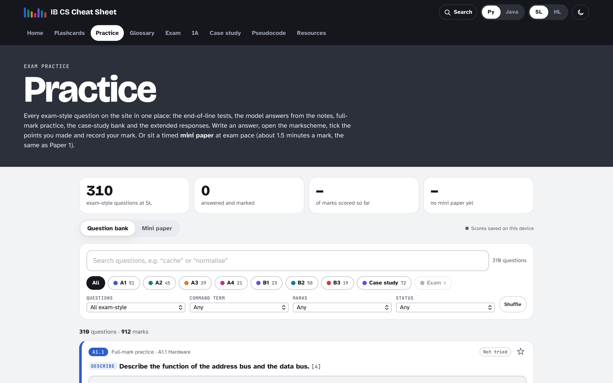
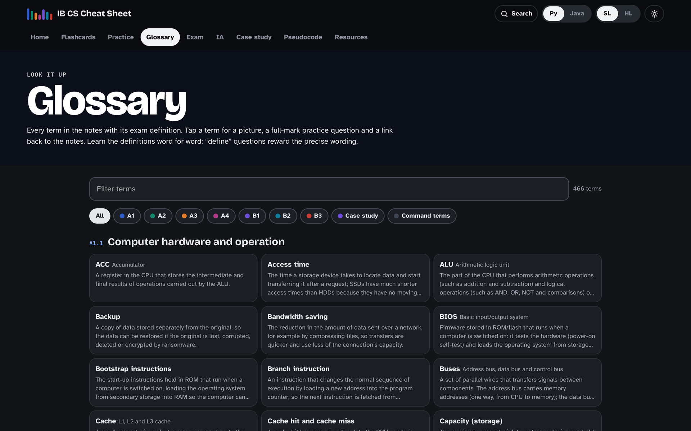

# IB Computer Science Notes

### Everything you need for IB CS, explained in plain words 💡

Notes, flashcards, practice questions and exam guides for **SL and HL**, made for the **2027 syllabus**.

 

&nbsp;

✅ 100% free &nbsp;·&nbsp; ✅ No sign-up &nbsp;·&nbsp; ✅ No ads &nbsp;·&nbsp; ✅ Works on your phone

  

<picture>
  <source media="(prefers-color-scheme: dark)" srcset=".github/screenshots/home-dark.png">
  
</picture>

 

## 👋 New here? Start in 3 steps

<table>
  <tr>
    <td width="33%" valign="top" align="center">
      <h3>1️⃣</h3>
      <b><a href="https://d1v4nchik.github.io/dpcomputerscience27/">Open the notes</a></b> 
      It's just a website. Nothing to install, no account needed.
    </td>
    <td width="33%" valign="top" align="center">
      <h3>2️⃣</h3>
      <b>Pick SL or HL</b> 
      Use the switch at the top. You can also pick Python or Java for code examples.
    </td>
    <td width="33%" valign="top" align="center">
      <h3>3️⃣</h3>
      <b>Choose a topic and go</b> 
      Read the notes, then test yourself in <b>Practice</b>. Your progress saves by itself.
    </td>
  </tr>
</table>

> [!TIP]
> Press <kbd>/</kbd> on any page to search for a word, a topic or a whole exam question.

## 🎒 What's inside

<table>
  <tr>
    <td align="center" width="25%"><h2>23</h2>topic pages</td>
    <td align="center" width="25%"><h2>1,394</h2>flashcards</td>
    <td align="center" width="25%"><h2>546</h2>practice questions</td>
    <td align="center" width="25%"><h2>719</h2>glossary terms</td>
  </tr>
</table>

Numbers are for HL. SL has 16 topic pages, 907 flashcards, 346 questions and 497 terms, because HL-only content is hidden.

- 🗺️ **Notes as a map**: Every topic is a coloured line and every page is a stop, so you always know where you are. Each idea has an exam definition, a plain-words explanation and an everyday example.
- 📝 **Short or long**: Switch between quick cheat-sheet points and full textbook-style explanations.
- 🎬 **Videos**: A short video for almost every syllabus point (136 in total).
- 🃏 **Flashcards and games**: Learn, Write and Test modes, plus Match, Memory, Gravity and Blitz. Cards explain *why* the answer is right.
- ✍️ **Exam practice**: Write your answer, open the markscheme and tick off what you got. Or sit a timed paper.
- 📖 **Glossary**: Every key term with a full-mark definition. Underlined words in the notes open their meaning.
- 🧭 **Guides**: How each exam paper works, the IA, pseudocode and the 2027 case study.
- 🌙 **Dark mode**: Easy on the eyes at night, on any screen.

## 📴 Studying without internet

On a plane, on the bus or stuck with bad wifi? Pick one:

<table>
  <tr>
    <td width="50%" valign="top">
      <h3>📲 Install it as an app</h3>
      <b>⭐ Recommended</b>  
      Keeps every topic on your device and opens offline. 
      ✅ <b>Updates itself</b> whenever you're back online.
        
      <b>Laptop</b> (Chrome or Edge): open the notes and click the <b>Install</b> icon at the right of the address bar. 
      <b>iPhone / iPad</b> (Safari): tap <b>Share</b>, then <b>Add to Home Screen</b>. 
      <b>Android</b> (Chrome): tap <b>⋮</b>, then <b>Install app</b>.
    </td>
    <td width="50%" valign="top">
      <h3>💾 Download one file</h3>
      <b>For laptops</b>  
      One file with all the notes. Double-click it to open it in your browser. No internet needed. 
      ⚠️ <b>Doesn't update itself.</b> If newer notes come out, it will show a message (when you're online) so you can download it again.
        
      <a href="https://github.com/d1v4nchik/dpcomputerscience27/releases/download/offline/ib-cs-notes-offline.html"><b>⬇️ Download the file</b></a>
    </td>
  </tr>
</table>

> [!NOTE]
> Open the notes once with internet before you go offline, so the app has time to save everything.

## 🖼️ A quick look

<table>
  <tr>
    <td width="50%"> <b>Topic page.</b> Stops along the line, exam definitions and diagrams.</td>
    <td width="50%"> <b>Flashcards.</b> Learn mode, plus Write, Test and four games.</td>
  </tr>
  <tr>
    <td width="50%"> <b>Practice.</b> Filter by topic, command term and marks, then self-mark.</td>
    <td width="50%"> <b>Glossary.</b> Every term with its full-mark definition (dark mode).</td>
  </tr>
</table>

  
  &nbsp;&nbsp;
  

## ❓ Questions

<b>Is it really free?</b>

 
Yes. No payments, no ads and no account. Just open it and study.

<b>Where is my progress saved?</b>

 
In your browser, on the device you're using. Nobody else can see it. Because there's no account, progress on your laptop and your phone stays separate.

<b>Does it cover my syllabus?</b>

 
It's written for IB Computer Science with <b>first exams in 2027</b>, both SL and HL. Here's every topic:
  

**Theme A: Concepts of computer science (Paper 1)**

| Line | Topic | Pages |
| :--- | :--- | :--- |
|  | Computer fundamentals | A1.1 Hardware and operation · A1.2 Data and logic · A1.3 Operating and control systems · A1.4 Translation **HL** |
|  | Networks | A2.1 Network fundamentals · A2.2 Network architecture · A2.3–4 Transmission and security |
|  | Databases | A3.1–2 Relational design · A3.3 SQL · A3.4 Beyond relational **HL** |
|  | Machine learning | A4.1 Machine learning fundamentals · A4.2 Preparing data **HL** · A4.3.1–5 Learning from data **HL** · A4.3.6–10 Rewards, evolution, neurons **HL** · A4.4 Ethical considerations |

**Theme B: Computational thinking and programming (Paper 2)**

| Line | Topic | Pages |
| :--- | :--- | :--- |
|  | Computational thinking | B1.1 Thinking like a programmer |
|  | Programming | B2.1 Fundamentals · B2.2 Data structures · B2.3 Control structures · B2.4–5 Algorithms and files |
|  | Object-oriented programming | B3.1 Classes and objects · B3.2 Inheritance and design **HL** |
|  | Abstract data types **HL** | B4.1 Linked lists, trees, sets, hashes **HL** |

**Guides:** Exam toolkit · Internal assessment (IA) · 2027 case study · Pseudocode help · Resources

<b>Is this official IB material?</b>

 
No. These are independent study notes. They're not made by, endorsed by or connected to the International Baccalaureate Organization. "IB" and "International Baccalaureate" are trademarks of the International Baccalaureate Organization. Always double-check with the official subject guide and your teacher.

<b>I found a mistake. What do I do?</b>

 
Thank you! Please <a href="https://github.com/d1v4nchik/dpcomputerscience27/issues/new?template=correction.yml">send a correction</a>. Say which topic it's in (for example <i>A2.1</i>) and what's wrong. You'll need a free GitHub account. Have an idea instead? <a href="https://github.com/d1v4nchik/dpcomputerscience27/issues/new?template=suggestion.yml">Make a suggestion</a>.

<b>Can I share it?</b>

 
Please do! Send the <a href="https://d1v4nchik.github.io/dpcomputerscience27/">link</a> to your classmates and teachers. The notes are © d1v4nchik, all rights reserved, so please share the link rather than copying, reposting or selling the content.

 

**Good luck with your exams! 🍀**

Want to help edit the site itself? See <a href="CONTRIBUTING.md">CONTRIBUTING.md</a>.

