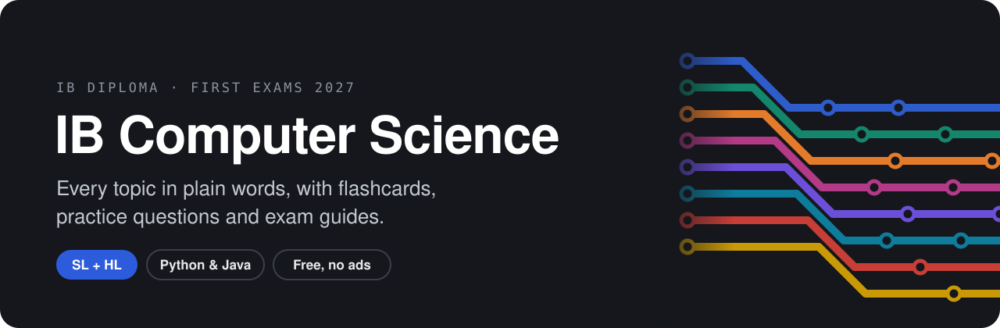
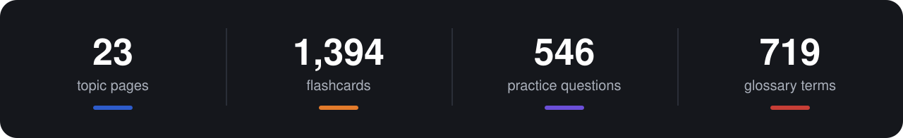
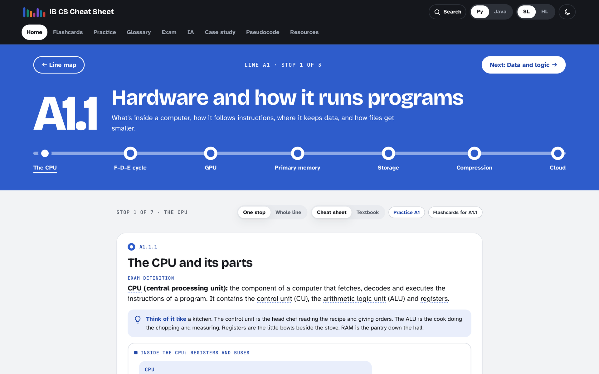

  

  
  &nbsp;
  

Free &nbsp;&middot;&nbsp; No sign-up &nbsp;&middot;&nbsp; No ads &nbsp;&middot;&nbsp; Works on phones and laptops

 

  <picture>
    <source media="(prefers-color-scheme: dark)" srcset=".github/screenshots/home-dark.png">
    
  </picture>

 

## Getting started

<table>
  <tr>
    <td width="33%" valign="top">
      STEP 1 
      <b><a href="https://d1v4nchik.github.io/dpcomputerscience27/">Open the notes</a></b> 
      It's a normal website. Nothing to install and no account.
    </td>
    <td width="33%" valign="top">
      STEP 2 
      <b>Choose SL or HL</b> 
      Use the switch at the top. Pick Python or Java for code too.
    </td>
    <td width="33%" valign="top">
      STEP 3 
      <b>Pick a topic</b> 
      Read the notes, then test yourself in Practice. Progress saves by itself.
    </td>
  </tr>
</table>

Press <kbd>/</kbd> on any page to search for a word, a topic or a whole exam question.

## What's inside

Totals for HL. SL shows 16 topic pages, 907 flashcards, 346 questions and 497 terms.

<table>
  <tr>
    <td width="50%" valign="top"><b>Notes as a map</b> Each topic is a coloured line and each page is a stop. Every idea has an exam definition, a plain explanation and an everyday example.</td>
    <td width="50%" valign="top"><b>Short or long</b> Switch between quick cheat-sheet points and full textbook-style explanations.</td>
  </tr>
  <tr>
    <td valign="top"><b>Flashcards and games</b> Learn, Write and Test modes, plus four quick games. Cards explain why the answer is right.</td>
    <td valign="top"><b>Exam practice</b> Write an answer, open the markscheme and tick off what you got, or sit a timed paper.</td>
  </tr>
  <tr>
    <td valign="top"><b>Glossary</b> Every key term with a full-mark definition. Underlined words in the notes open their meaning.</td>
    <td valign="top"><b>Videos and guides</b> A short video for almost every syllabus point, plus guides to the papers, the IA, pseudocode and the case study.</td>
  </tr>
</table>

<h2 id="study-without-internet">Study without internet</h2>

<table>
  <tr>
    <td width="50%" valign="top">
      <b>Install it as an app</b> &nbsp;RECOMMENDED  
      Saves every topic on your device, opens offline, and <b>updates itself</b> whenever you're back online.  
      <b>Laptop</b> &nbsp;In Chrome or Edge, click <i>Install</i> at the right of the address bar. 
      <b>iPhone, iPad</b> &nbsp;In Safari, tap <i>Share</i>, then <i>Add to Home Screen</i>. 
      <b>Android</b> &nbsp;In Chrome, tap the menu, then <i>Install app</i>.
    </td>
    <td width="50%" valign="top">
      <b>Download one file</b> &nbsp;LAPTOPS  
      A single file with all the notes. Double-click it to open it in your browser, with no internet needed.  
      <b>It doesn't update itself.</b> When newer notes come out, it shows a message (if you're online) so you can download it again.  
      <a href="https://github.com/d1v4nchik/dpcomputerscience27/releases/download/offline/ib-cs-notes-offline.html"><b>Download the file</b></a>
    </td>
  </tr>
</table>

Open the notes once with internet before going offline, so the app has time to save everything.

## A quick look

<table>
  <tr>
    <td width="50%"> <b>Topic page.</b> Stops along the line, exam definitions and diagrams.</td>
    <td width="50%"> <b>Flashcards.</b> Learn mode, plus Write, Test and four games.</td>
  </tr>
  <tr>
    <td width="50%"> <b>Practice.</b> Filter by topic, command term and marks, then self-mark.</td>
    <td width="50%"> <b>Glossary.</b> Every term with its full-mark definition (dark mode).</td>
  </tr>
</table>

  
  &nbsp;&nbsp;
  

## Questions

<b>Is it really free?</b>

 
Yes. No payments, no ads and no account.

<b>Where is my progress saved?</b>

 
In your browser, on the device you're using. Nobody else can see it, and your laptop and phone keep separate progress.

<b>Which topics does it cover?</b>

 
The whole IB Computer Science course with first exams in 2027, SL and HL.
  

**Theme A: Concepts of computer science (Paper 1)**

| Line | Topic | Pages |
| :--- | :--- | :--- |
|  | Computer fundamentals | A1.1 Hardware and operation · A1.2 Data and logic · A1.3 Operating and control systems · A1.4 Translation **HL** |
|  | Networks | A2.1 Network fundamentals · A2.2 Network architecture · A2.3–4 Transmission and security |
|  | Databases | A3.1–2 Relational design · A3.3 SQL · A3.4 Beyond relational **HL** |
|  | Machine learning | A4.1 Machine learning fundamentals · A4.2 Preparing data **HL** · A4.3.1–5 Learning from data **HL** · A4.3.6–10 Rewards, evolution, neurons **HL** · A4.4 Ethical considerations |

**Theme B: Computational thinking and programming (Paper 2)**

| Line | Topic | Pages |
| :--- | :--- | :--- |
|  | Computational thinking | B1.1 Thinking like a programmer |
|  | Programming | B2.1 Fundamentals · B2.2 Data structures · B2.3 Control structures · B2.4–5 Algorithms and files |
|  | Object-oriented programming | B3.1 Classes and objects · B3.2 Inheritance and design **HL** |
|  | Abstract data types **HL** | B4.1 Linked lists, trees, sets, hashes **HL** |

**Guides:** Exam toolkit · Internal assessment (IA) · 2027 case study · Pseudocode help · Resources

<b>Is this official IB material?</b>

 
No. These are independent study notes, not made by, endorsed by or connected to the International Baccalaureate Organization. "IB" and "International Baccalaureate" are its trademarks. Always check against the official subject guide and your teacher.

<b>I found a mistake</b>

 
Thank you. Please <a href="https://github.com/d1v4nchik/dpcomputerscience27/issues/new?template=correction.yml">send a correction</a> with the topic code (for example A2.1) and what's wrong. Have an idea instead? <a href="https://github.com/d1v4nchik/dpcomputerscience27/issues/new?template=suggestion.yml">Make a suggestion</a>. Both need a free GitHub account.

<b>Can I share it?</b>

 
Please do. Send the <a href="https://d1v4nchik.github.io/dpcomputerscience27/">link</a> to classmates and teachers. The notes are &copy; d1v4nchik, all rights reserved, so share the link rather than copying, reposting or selling the content.

 

<b>Good luck with your exams.</b>

<a href="CONTRIBUTING.md">Help edit the site</a>

